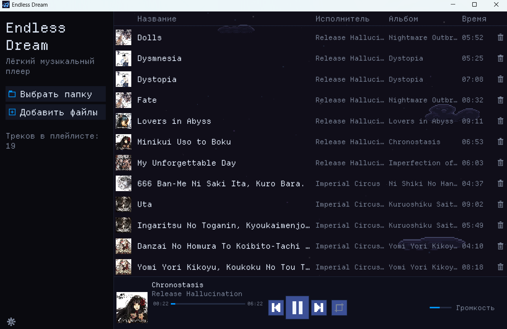

# Endless Dream

Музыкальный плеер для Windows на Rust с пиксельным интерфейсом.




## Возможности

- Поддержка MP3, FLAC, WAV, OGG, AAC, M4A.
- Сохранение плейлиста, громкости, настроек трея и масштаба между запусками.
- Системный трей (сворачивание, меню).
- Рекурсивное сканирование папок, чтение тегов и обложек.
- Масштабирование интерфейса (Ctrl + колесо мыши).

## Запуск

Скачайте `endless_dream.exe` из раздела [Releases](https://github.com/VoxSilentii/endless_dream/releases) и запустите. Rust не требуется.

## Сборка из исходников

Требуется Rust (edition 2024) и Windows 10/11.

```bash
git clone https://github.com/VoxSilentii/endless_dream.git
cd endless_dream
cargo run --release
